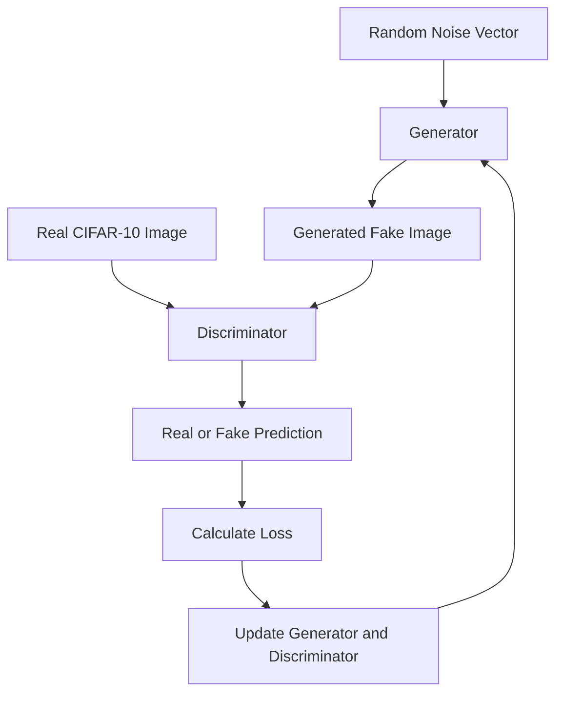

# EX.NO.6 – IMPLEMENTING A GENERATIVE ADVERSARIAL NETWORK (GAN)

## AIM

To understand and implement a Generative Adversarial Network (GAN) using PyTorch and train the network on the CIFAR-10 dataset to generate realistic synthetic images.

## INTRODUCTION

A Generative Adversarial Network (GAN) is a deep learning architecture used to generate new data that resembles the original training data.

GANs consist of two neural networks called the Generator and the Discriminator. These two networks compete against each other during training to improve the quality of generated images.

The Generator creates fake images from random noise, while the Discriminator attempts to distinguish between real images and generated fake images.

Through this adversarial training process, the Generator gradually learns to produce realistic images.

**Applications of GANs:**

1. Image generation
2. Image enhancement
3. Face generation
4. Image-to-image translation
5. Data augmentation
6. Artificial image synthesis

## DATASET DESCRIPTION

In this experiment, the CIFAR-10 dataset is used to train the GAN.

The CIFAR-10 dataset contains 60,000 color images belonging to ten different categories.

**Dataset Details:**

- Training Images: 50,000
- Testing Images: 10,000 (not used in this training procedure)
- Image Size: 32 × 32 pixels
- Color Channels: 3 (RGB)
- Number of Classes: 10

**The ten classes are:**

1. Airplane
2. Automobile
3. Bird
4. Cat
5. Deer
6. Dog
7. Frog
8. Horse
9. Ship
10. Truck

## WORKING PRINCIPLE OF GAN

A GAN consists of two main components:

### 1. GENERATOR

The Generator takes a random noise vector as input and produces synthetic images.

Its main objective is to generate images that look realistic enough to fool the Discriminator.

### 2. DISCRIMINATOR

The Discriminator receives both real images from the dataset and fake images generated by the Generator.

Its objective is to classify whether an image is real or fake.

### ADVERSARIAL TRAINING

Both networks are trained simultaneously:

- The Generator tries to fool the Discriminator.
- The Discriminator tries to correctly identify fake images.
- The Generator improves its image generation ability through feedback from the Discriminator.

## PROCEDURE

### STEP 1: IMPORTING REQUIRED LIBRARIES

Import the necessary Python libraries for implementing GAN using PyTorch.

- PyTorch: Used to build and train neural networks.
- Torchvision: Used to load datasets and process images.
- Matplotlib: Used to visualize generated images.
- NumPy: Used for numerical operations.

```python
import torch
import torch.nn as nn
import torch.optim as optim
import torchvision

from torchvision import datasets, transforms

import matplotlib.pyplot as plt
import numpy as np

device = torch.device(
    'cuda' if torch.cuda.is_available() else 'cpu'
)

print("Using device:", device)
```

### STEP 2: DEFINING IMAGE TRANSFORMATIONS

Image transformations are applied to convert images into tensors and normalize pixel values between -1 and 1.

Normalization helps improve training stability.

```python
transform = transforms.Compose([
    transforms.ToTensor(),
    transforms.Normalize(
        (0.5, 0.5, 0.5),
        (0.5, 0.5, 0.5)
    )
])
```

### STEP 3: LOADING THE CIFAR-10 DATASET

The CIFAR-10 training dataset is downloaded and loaded using the torchvision datasets module.

DataLoader is used to divide the dataset into mini-batches of size 32 and shuffle the images during training.

```python
train_dataset = datasets.CIFAR10(
    root='./data',
    train=True,
    download=True,
    transform=transform
)

dataloader = torch.utils.data.DataLoader(
    train_dataset,
    batch_size=32,
    shuffle=True
)
```

### STEP 4: DEFINING GAN HYPERPARAMETERS

Hyperparameters are defined to control the training process.

- **latent_dim:** Dimensionality of the random noise vector.
- **lr:** Learning rate of the optimizers.
- **beta1 and beta2:** Parameters used by the Adam optimizer.
- **num_epochs:** Number of complete training cycles.

```python
latent_dim = 100

lr = 0.0002

beta1 = 0.5
beta2 = 0.999

num_epochs = 10
```

### STEP 5: BUILDING THE GENERATOR

The Generator is a neural network that converts random noise into synthetic images.

It uses fully connected, convolutional, upsampling, batch normalization, and activation layers.

**Layers Used:**

1. Linear Layer: Converts the noise vector into a feature representation.
2. ReLU Activation: Introduces non-linearity.
3. Unflatten: Converts the feature vector into a 3D feature map.
4. Upsampling: Increases the spatial dimensions of feature maps.
5. Convolutional Layer: Extracts and refines image features.
6. Batch Normalization: Stabilizes the training process.
7. Tanh Activation: Scales the generated image values between -1 and 1.

```python
class Generator(nn.Module):

    def __init__(self, latent_dim):

        super(Generator, self).__init__()

        self.model = nn.Sequential(

            nn.Linear(latent_dim, 128 * 8 * 8),

            nn.ReLU(),

            nn.Unflatten(1, (128, 8, 8)),

            nn.Upsample(scale_factor=2),

            nn.Conv2d(
                128, 128,
                kernel_size=3,
                padding=1
            ),

            nn.BatchNorm2d(
                128,
                momentum=0.78
            ),

            nn.ReLU(),

            nn.Upsample(scale_factor=2),

            nn.Conv2d(
                128, 64,
                kernel_size=3,
                padding=1
            ),

            nn.BatchNorm2d(
                64,
                momentum=0.78
            ),

            nn.ReLU(),

            nn.Conv2d(
                64, 3,
                kernel_size=3,
                padding=1
            ),

            nn.Tanh()
        )

    def forward(self, z):

        img = self.model(z)

        return img
```

### STEP 6: BUILDING THE DISCRIMINATOR

The Discriminator is a binary classification neural network that distinguishes between real and fake images.

It uses convolutional layers, batch normalization, dropout, LeakyReLU activation, and a Sigmoid output layer.

**Layers Used:**

1. Convolutional Layer: Extracts features from input images.
2. LeakyReLU: Introduces non-linearity while allowing a small gradient for negative values.
3. Dropout: Helps prevent overfitting.
4. Batch Normalization: Stabilizes the learning process.
5. Flatten: Converts feature maps into a one-dimensional vector.
6. Fully Connected Layer: Produces the final classification output.
7. Sigmoid Activation: Produces a probability between 0 and 1.

```python
class Discriminator(nn.Module):

    def __init__(self):

        super(Discriminator, self).__init__()

        self.model = nn.Sequential(

            nn.Conv2d(
                3, 32,
                kernel_size=3,
                stride=2,
                padding=1
            ),

            nn.LeakyReLU(0.2),

            nn.Dropout(0.25),

            nn.Conv2d(
                32, 64,
                kernel_size=3,
                stride=2,
                padding=1
            ),

            nn.ZeroPad2d((0, 1, 0, 1)),

            nn.BatchNorm2d(
                64,
                momentum=0.82
            ),

            nn.LeakyReLU(0.25),

            nn.Dropout(0.25),

            nn.Conv2d(
                64, 128,
                kernel_size=3,
                stride=2,
                padding=1
            ),

            nn.BatchNorm2d(
                128,
                momentum=0.82
            ),

            nn.LeakyReLU(0.2),

            nn.Dropout(0.25),

            nn.Conv2d(
                128, 256,
                kernel_size=3,
                stride=1,
                padding=1
            ),

            nn.BatchNorm2d(
                256,
                momentum=0.8
            ),

            nn.LeakyReLU(0.25),

            nn.Dropout(0.25),

            nn.Flatten(),

            nn.Linear(256 * 5 * 5, 1),

            nn.Sigmoid()
        )

    def forward(self, img):

        validity = self.model(img)

        return validity
```

### STEP 7: INITIALIZING GAN COMPONENTS

The Generator and Discriminator are initialized and moved to the available computing device (GPU or CPU).

Binary Cross-Entropy (BCE) is used as the loss function.

Adam optimizers are defined separately for both networks.

```python
generator = Generator(latent_dim).to(device)

discriminator = Discriminator().to(device)

adversarial_loss = nn.BCELoss()

optimizer_G = optim.Adam(
    generator.parameters(),
    lr=lr,
    betas=(beta1, beta2)
)

optimizer_D = optim.Adam(
    discriminator.parameters(),
    lr=lr,
    betas=(beta1, beta2)
)
```

### STEP 8: TRAINING THE GAN

The GAN is trained using adversarial learning.

The training process involves the following steps:

1. Load real images from the CIFAR-10 dataset.
2. Generate random noise vectors.
3. Pass random noise through the Generator to create fake images.
4. Train the Discriminator using real and fake images.
5. Calculate the Discriminator loss.
6. Update the Discriminator weights.
7. Train the Generator to fool the Discriminator.
8. Calculate the Generator loss.
9. Update the Generator weights.
10. Repeat the process for the specified number of epochs.

**Important Training Components:**

- `valid`: Creates labels of 1 for real images.
- `fake`: Creates labels of 0 for generated images.
- `torch.randn()`: Generates random noise vectors.
- `g_loss`: Measures how well the Generator fools the Discriminator.
- `d_loss`: Measures the Discriminator's classification error.

```python
for epoch in range(num_epochs):

    for i, batch in enumerate(dataloader):

        real_images = batch[0].to(device)

        valid = torch.ones(
            real_images.size(0), 1,
            device=device
        )

        fake = torch.zeros(
            real_images.size(0), 1,
            device=device
        )

        # Train Discriminator

        optimizer_D.zero_grad()

        z = torch.randn(
            real_images.size(0),
            latent_dim,
            device=device
        )

        fake_images = generator(z)

        real_loss = adversarial_loss(
            discriminator(real_images),
            valid
        )

        fake_loss = adversarial_loss(
            discriminator(fake_images.detach()),
            fake
        )

        d_loss = (real_loss + fake_loss) / 2

        d_loss.backward()

        optimizer_D.step()

        # Train Generator

        optimizer_G.zero_grad()

        gen_images = generator(z)

        g_loss = adversarial_loss(
            discriminator(gen_images),
            valid
        )

        g_loss.backward()

        optimizer_G.step()

        # Display Training Loss

        if (i + 1) % 100 == 0:

            print(
                f"Epoch [{epoch+1}/{num_epochs}] "
                f"Batch {i+1}/{len(dataloader)} "
                f"Discriminator Loss: {d_loss.item():.4f} "
                f"Generator Loss: {g_loss.item():.4f}"
            )

    # Generate sample images after every 10 epochs

    if (epoch + 1) % 10 == 0:

        with torch.no_grad():

            z = torch.randn(
                16,
                latent_dim,
                device=device
            )

            generated = generator(z).detach().cpu()

            grid = torchvision.utils.make_grid(
                generated,
                nrow=4,
                normalize=True
            )

            plt.imshow(
                np.transpose(grid.numpy(), (1, 2, 0))
            )

            plt.axis("off")

            plt.title(
                f"Generated Images - Epoch {epoch+1}"
            )

            plt.show()
```

## GAN ARCHITECTURE

The Generator and Discriminator work together through adversarial training.



## OUTPUT ANALYSIS

### GENERATOR OUTPUT

The Generator produces synthetic images from random noise vectors.

During training, the generated images gradually improve as the Generator learns the features and patterns present in the CIFAR-10 dataset.

### DISCRIMINATOR OUTPUT

The Discriminator evaluates both real and generated images and predicts whether they are real or fake.

### TRAINING LOSS

- Generator Loss indicates how effectively the Generator fools the Discriminator.
- Discriminator Loss indicates how effectively the Discriminator distinguishes real and fake images.
- Both networks improve through continuous adversarial training.

### GENERATED IMAGE VISUALIZATION

The generated images are displayed in a 4 × 4 grid after the training process reaches the specified epoch.

The quality of generated images can be observed to understand how the Generator improves during training.

## RESULT

Thus, a Generative Adversarial Network (GAN) was successfully implemented using PyTorch and trained on the CIFAR-10 dataset. The Generator learned to produce synthetic images from random noise, while the Discriminator learned to distinguish between real and generated images through adversarial training.

## CONCLUSION

The experiment demonstrates the working principle and implementation of Generative Adversarial Networks. The roles of the Generator, Discriminator, loss function, and Adam optimizer were understood. The process of generating synthetic images through adversarial learning was successfully explored.

## APPLICATIONS OF GAN

1. Realistic image generation.
2. Artificial face generation.
3. Image enhancement and restoration.
4. Medical image synthesis.
5. Data augmentation for machine learning.
6. Image-to-image translation.
